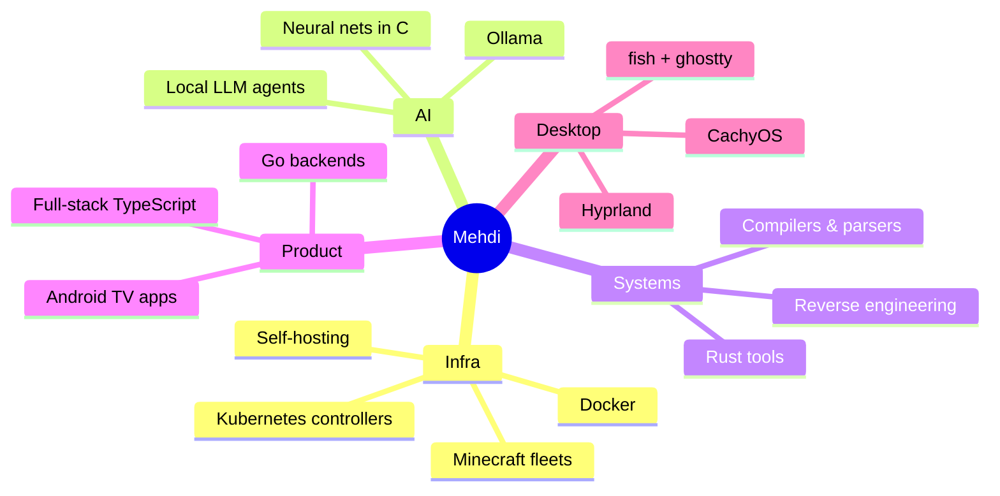

<!-- ░░ header ░░ -->
<p align="center">
  
</p>

<p align="center">
  <a href="https://github.com/mehdii000">
    
  </a>
</p>

<p align="center">
  <a href="https://mehdidev.xyz/"></a>
  
  
  
</p>

<br/>

## `$ whoami`

<table>
<tr>
<td width="56%" valign="top">

Hey, I'm **Mehdi** 👋 — a developer who can't stay on one layer of the stack.

One week I'm writing a **Go controller that keeps a warm pool of Minecraft servers** alive on Kubernetes; the next I'm training a **neural net in plain C** with nothing but matrices and backprop, or building a **Rust agent harness** that talks to models running on my own machine.

I like tools that are **local-first, private, and fast** — no cloud account, no telemetry, no nonsense. I also like fixing things for real people: I built a **one-button Arabic TV launcher for my grandmother** and dug an infected Android TV box apart to get it clean again.

- 🔭 Right now: **Planck** (local agent harness) and **nbai** (Android ↔ Linux bridge)
- 🌱 Digging into: k8s operators, compilers, reverse engineering
- 🎮 Long-time Minecraft / Skyblock modder
- 💬 Ask me about: Linux, Go, self-hosting, why your distro should be CachyOS

</td>
<td width="44%" valign="top">

```fish
mehdi@cachyos ~> fastfetch
  ╭──────────────────────────╮
  │  mehdi @ cachyos         │
  ╰──────────────────────────╯
  os       CachyOS x86_64
  kernel   linux-cachyos
  wm       Hyprland (wayland)
  shell    fish + atuin
  term     ghostty
  editor   zed
  git      lazygit
  monitor  btop
  ai       ollama (local)
  langs    ts go py rust c
  status   ▓▓▓▓▓▓▓▓▓░ shipping
```

</td>
</tr>
</table>

## 🐧 Daily driver: CachyOS

<p>
  
</p>

Arch underneath, but tuned: **x86-64-v3/v4 optimised packages**, a BORE-scheduled kernel, and sane defaults out of the box. It's fast, it stays out of my way, and it lets me tinker as deep as I want. Paired with **Hyprland**, **Ghostty** and **fish**, it's the cleanest dev setup I've had.

<br clear="right"/>

## 🛠️ Toolbox

<p align="center">
  
  <br/><br/>
  
  <br/><br/>
  
</p>

<p align="center">
  
  
  
  
  
  
  
  
</p>

## 🚀 Things I've built

<table>
<tr>
<td width="50%" valign="top">

### 📱 [nbai](https://github.com/mehdii000/nbai)
<sub>Rust · Linux · Android</sub><br/>
**N**ot **B**uying **A**n **i**Phone. Keeps your Android phone wired into your Linux desktop over authenticated Wireless ADB — scrcpy mirroring on demand and native notifications. No cloud, no LAN listener.

</td>
<td width="50%" valign="top">

### ⛏️ [RedstoneKube](https://github.com/mehdii000/RedstoneKube)
<sub>Go · Kubernetes · PaperMC</sub><br/>
Disposable Minecraft minigames on k8s. A stdlib-only Go controller keeps warm pools of game pods, registers them with a custom Velocity proxy, recycles them, and serves a live metrics dashboard.

</td>
</tr>
<tr>
<td valign="top">

### 🤖 [Planck](https://github.com/mehdii000/Planck)
<sub>Rust · TUI · Local LLMs</sub><br/>
A fast, local-first agent harness for Ollama, llama.cpp, LM Studio — anything OpenAI-compatible. Full-screen TUI, model picker, safe/auto/yolo modes.

</td>
<td valign="top">

### 🧠 [exLatticeV2](https://github.com/mehdii000/exLatticeV2)
<sub>C · ML from scratch</sub><br/>
A matrix-based neural network in pure C — forward pass, backprop and training loop with zero dependencies. Because you only really get it once you write it yourself.

</td>
</tr>
<tr>
<td valign="top">

### 📺 [arabic-tv-home](https://github.com/mehdii000/arabic-tv-home)
<sub>Java · Android TV</sub><br/>
A one-button Arabic Android TV launcher built for my grandmother, with local weather and tested on the real device.

</td>
<td valign="top">

### 🔬 [x96q-recovery-research](https://github.com/mehdii000/x96q-recovery-research)
<sub>Python · Reverse engineering</sub><br/>
Evidence-led recovery of an infected X96Q Android TV box, plus an experimental, version-pinned guard against Cobalt video-ad loaders.

</td>
</tr>
</table>

<details>
<summary><b>📦 More projects</b> <sub>(click to expand)</sub></summary>
<br/>

| Project | Stack | What it is |
|---|---|---|
| [EAMLCompiler](https://github.com/mehdii000/EAMLCompiler) | C++ | A tiny markup language with reusable components that compiles to HTML/CSS |
| [memath-parser](https://github.com/mehdii000/memath-parser) | C++ | Mathematical expression parsing toolkit |
| [SuperiorAgent](https://github.com/mehdii000/SuperiorAgent) | Python | Modular, session-aware AI agent with dynamic tool calling (Ollama / Qwen) |
| [SocialPlatform](https://github.com/mehdii000/SocialPlatform) | TS · Python · Docker | Full-stack, multi-container social network |
| [exLattice](https://github.com/mehdii000/exLattice) | C | The educational v1 feed-forward network |
| [localP2PChat](https://github.com/mehdii000/localP2PChat) | Go | Peer-to-peer chat on the local network |
| [inventory-hub](https://github.com/mehdii000/inventory-hub) | TypeScript | Data processor and analytics engine |
| [BadAddons](https://github.com/mehdii000/BadAddons) | Java | Hypixel Skyblock QoL mod |

</details>

<details>
<summary><b>🗺️ How my brain is wired</b> <sub>(click to expand)</sub></summary>
<br/>



</details>

## 📊 Stats

<p align="center">
  
</p>
<p align="center">
  
  
</p>
<p align="center">
  
</p>

<p align="center">
  <picture>
    <source media="(prefers-color-scheme: dark)" srcset="https://raw.githubusercontent.com/mehdii000/mehdii000/output/github-snake-dark.svg"/>
    <source media="(prefers-color-scheme: light)" srcset="https://raw.githubusercontent.com/mehdii000/mehdii000/output/github-snake.svg"/>
    
  </picture>
</p>

<!-- ░░ footer ░░ -->
<p align="center">
  
</p>
